<div align="center">


<br/>

<a href="#about"></a>
<a href="#services"></a>
<a href="#missions"></a>
<a href="#stack"></a>
<a href="#process"></a>
<a href="https://t.me/+afel2qXC9-pkNzAy"></a>

<br/><br/>


</div>

<br/>

<a id="about"></a>
<div align="center">


<br/><br/>

</div>

<br/>

I'm a **full-cycle product engineer**. I take a business idea or a painful manual process and turn it into working software: **B2B SaaS platforms, websites, mobile apps, games, Telegram and Discord bots, and automation**. One person accountable from the first call to production, with a small circle of trusted specialists when a project needs more hands.

**Why teams work with me**

- **One owner, zero hand-offs.** Product thinking, architecture, code, deploy and support all sit with the same person, so nothing gets lost between "design" and "dev".
- **Business first.** I care about revenue, retention and support load, not just tickets closed. Every feature has to earn its place.
- **Fast to first value.** Typical MVP in weeks, not quarters. You see working software every week.
- **Production-grade by default.** Typed code, tests where they matter, CI/CD, monitoring and alerts. It keeps running after I leave the room.
- **You own everything.** Code, infrastructure, documentation and accounts are yours from day one.

<br/>

<a id="services"></a>
<div align="center">

<br/><br/>

<a href="https://t.me/+afel2qXC9-pkNzAy"></a><a href="https://t.me/+afel2qXC9-pkNzAy"></a><a href="https://t.me/+afel2qXC9-pkNzAy"></a>
<a href="https://t.me/+afel2qXC9-pkNzAy"></a><a href="https://t.me/+afel2qXC9-pkNzAy"></a><a href="https://t.me/+afel2qXC9-pkNzAy"></a>
</div>

<br/>

<a id="missions"></a>
<div align="center">


<br/><br/>

<a href="https://t.me/+afel2qXC9-pkNzAy"></a><a href="https://t.me/+afel2qXC9-pkNzAy"></a><a href="https://t.me/+afel2qXC9-pkNzAy"></a>
</div>

<details>
<summary><b>Fleetwise</b>: the full story</summary>
<br/>

- **Challenge:** carriers ran dispatch and invoicing through spreadsheets and chats. Errors were constant and nobody trusted the numbers.
- **What I built:** a multi-tenant web platform with role-based access, live dispatch board, automated invoicing, Stripe billing and an analytics dashboard.
- **Result:** about 70% less manual work, 40+ companies onboarded, MVP live in 6 weeks.

</details>

<details>
<summary><b>Pocket Arena</b>: the full story</summary>
<br/>

- **Challenge:** a real-time card battler that stays fair, fast and cheat-resistant on mid-range phones.
- **What I built:** Unity client, authoritative Go game server, Redis matchmaking, in-game economy and live-ops tooling for events and balance changes.
- **Result:** 120k+ installs, stable 60 FPS on mid devices, and a content pipeline the team runs without me.

</details>

<details>
<summary><b>SupportPilot</b>: the full story</summary>
<br/>

- **Challenge:** a growing community and a support team drowning in repeat questions across Telegram and Discord.
- **What I built:** a bot suite with AI triage, knowledge-base answers, CRM sync, payments and smart hand-off to a human.
- **Result:** about 8k tickets a month handled, 62% resolved automatically, average reply under 3 seconds.

</details>

<br/>

<a id="stack"></a>
<div align="center">


<br/><br/>


</div>

<br/>

<a id="process"></a>
<div align="center">


<br/><br/>

</div>

<details>
<summary><b>Ways to work together</b></summary>
<br/>

| Model | Best for | How it works |
| --- | --- | --- |
| **Fixed-scope project** | MVPs, launches, well-defined features | Clear scope, milestones and a fixed quote |
| **Dedicated engineer** | Ongoing product development | Monthly retainer, you steer the priorities |
| **Technical partner** | Founders without a CTO | Architecture, hiring help and hands-on building |
| **Audit and rescue** | Stuck or inherited codebases | Review, stabilise, then ship what was blocked |

</details>

<br/>

<a id="faq"></a>
<div align="center">

</div>

<br/>

<details>
<summary><b>How do we start?</b></summary>
<br/>

Send a short message with your goal. We hop on a free discovery call, I come back with a scope, a timeline and a quote. No pitch decks, no pressure.

</details>

<details>
<summary><b>How long does an MVP take?</b></summary>
<br/>

Usually 4 to 8 weeks depending on scope. You get a firm estimate after the discovery call, and a working demo every week along the way.

</details>

<details>
<summary><b>How does pricing work?</b></summary>
<br/>

Either a fixed quote split into milestones, or a monthly retainer for ongoing work. Everything is agreed up front, with no hidden fees.

</details>

<details>
<summary><b>Do you sign NDAs and transfer IP?</b></summary>
<br/>

Yes. An NDA is signed before we discuss details if you want one, and all code and IP are transferred to you on payment.

</details>

<details>
<summary><b>Can you join an existing team or codebase?</b></summary>
<br/>

Yes. I regularly take over existing products, add features, fix performance and security issues, and work alongside in-house teams.

</details>

<details>
<summary><b>What happens after launch?</b></summary>
<br/>

I stay available. Monitoring, bug fixes, iterations and new features are covered by a support retainer, or on demand.

</details>

<details>
<summary><b>Languages and time zones?</b></summary>
<br/>

English and Russian. Async-first communication with regular overlap for calls.

</details>

<br/>

<a id="contact"></a>
<div align="center">

<br/><br/>

<a href="https://t.me/+afel2qXC9-pkNzAy"></a>

<br/>

<details>
<summary></summary>
<br/>

```text
karl_junhky
```

<sub>Hit the copy icon in the corner of the block, then paste it into Discord search.</sub>

</details>

<br/>


</div>
